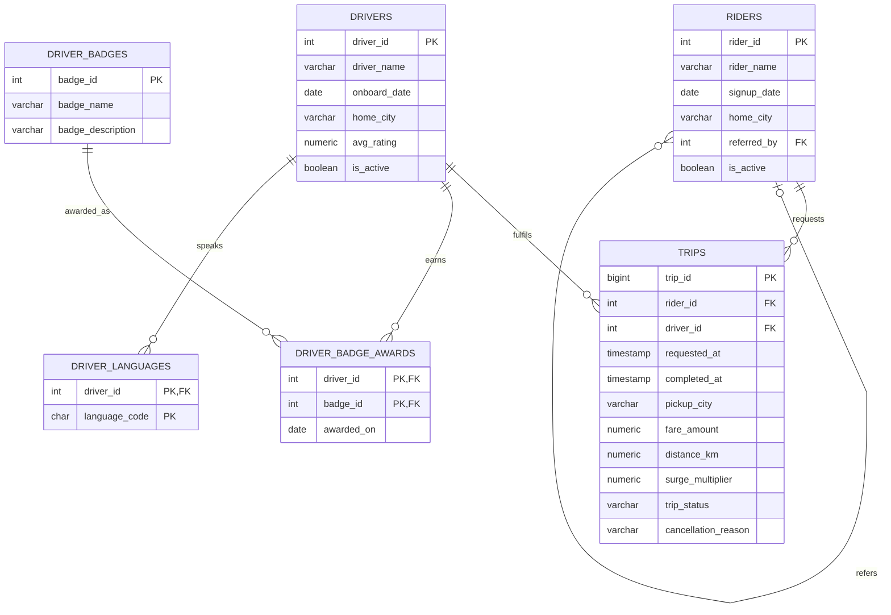

# EX603 — Ride-Sharing Database

A PostgreSQL analysis of a ride-sharing platform's trip records, investigating trip activity, driver performance, failed trips, and how the platform changed over 2023.

## Project Overview

This project explores the design and analysis of a relational database for a ride-sharing platform connecting riders with drivers. It demonstrates how SQL can help answer business questions, investigate operational problems, and support decisions using data.

The project progresses from relational database design and constraints to filtering, aggregation, joins, query execution analysis, and window functions.

The final analysis focuses on a central business question: **Is the platform's failure problem getting better or worse, and what should the team do next quarter?**

## Domain — Ride Sharing

The database models a ride-sharing platform where riders request transportation services and drivers fulfill trip requests. Each trip records the rider, the driver, the request and completion times, the pickup city, the distance, the surge multiplier, the fare amount, and the trip status (completed, cancelled, or disputed). Cancelled trips also record a cancellation reason. These records allow the platform to analyze trip activity, driver participation, and why trips fail.

The platform also tracks driver badges and awards. Drivers can receive multiple badges, and the same badge can be awarded to multiple drivers. This creates a many-to-many relationship represented through a junction table.

The database supports questions such as which riders and drivers participated in a trip, how many trips each driver handled, which trips generated the highest recorded fares, how rider no-shows and other unsuccessful trips changed over time, and whether there are gaps in recorded driver activity. These questions support both operational reporting and longer-term business decisions.

### Domain Components

| Component | Database Table or Attribute |
|---|---|
| Actor | Riders |
| Producer | Drivers |
| Event | Trips |
| Catalog | Driver Badges |
| Junction | Driver Badge Awards |
| Metric | Fare Amount |

## Database Overview

All SQL analysis in Units 3–6 runs on the course-provided Unit 3 dataset in the PostgreSQL database `ex603_data`. The DDL and data are in [`queries/unit3/rideshare.sql`](queries/unit3/rideshare.sql), which creates six tables and loads 200 trips, 30 riders, and 15 drivers.

| Table | Description | Used in |
|---|---|---|
| `trips` | The event table. One row per trip request: rider, driver, `requested_at`, `completed_at`, `pickup_city`, `fare_amount`, `distance_km`, `surge_multiplier`, `trip_status` (completed, cancelled, or disputed), and `cancellation_reason` (filled only for cancelled trips). | Units 3–6 |
| `drivers` | The producers: name, onboarding date, home city, licence number, average rating, and whether the driver is currently active. | Units 3–6 |
| `riders` | The actors: name, signup date, home city, email, and an optional `referred_by` link to another rider. | Units 3, 5 |
| `driver_badges` | The catalog of badges drivers can earn. | Unit 5 |
| `driver_badge_awards` | Junction table recording which badge was awarded to which driver, and when. | Unit 5 |
| `driver_languages` | The languages each driver speaks (a multivalued attribute stored in its own table). | Not used in the analysis |

Two details matter for the analysis: cancelled trips are stored with a `fare_amount` of 0.00, and `cancellation_reason` is NULL for completed and disputed trips.

### Entity Relationship Diagram (Unit 3 schema used for analysis)

The diagram shows the key columns of each table in `rideshare.sql`.



### Units 1–2 Design Exercise (not used for analysis)

Before the course dataset was provided, I designed my own five-table schema in Units 1 and 2. It is kept for reference, but it is **not** the schema the queries run on. For example, it has `started_at` and pickup/drop-off locations instead of `requested_at`, `trip_status`, and `cancellation_reason`.

- [Unit 1 ERD](schema/erd.png) and [Mermaid source](schema/erd.mmd)
- [Unit 2 schema](schema/schema.sql), with [constraint and `ON DELETE` reasoning](analysis/unit2.md)

## Query Catalogue

### Units 1–2 — Database Design

| Unit | Focus | Project Work |
|---|---|---|
| Unit 1 | Relational database design | Defined the platform entities and relationships in an [ERD](schema/erd.png) and [modelling justification](analysis/unit1.md). |
| Unit 2 | Schema implementation and constraints | Implemented the [design schema](schema/schema.sql) and explained the [constraint decisions](analysis/unit2.md). |

### Unit 3 — Finding the Dashboard Bug

| SQL File | Business Questions |
|---|---|
| [q3_1.sql](queries/unit3/q3_1.sql) | Which active drivers are highly rated? What trip statuses exist? How can trips be filtered by distance and city? Which trips have no cancellation reason? |
| [q3_2.sql](queries/unit3/q3_2.sql) | Why did the dashboard's failure count silently drop rows (`!=` excludes NULLs), and how does an explicit `IS NULL` repair it? Why can't a SELECT alias be used in WHERE? |
| [q3_3.sql](queries/unit3/q3_3.sql) | Which riders had rider no-show trips? (Answered four equivalent ways: IN, CTE, JOIN, and EXISTS.) |

### Unit 4 — From Rows to Insight

| SQL File | Business Questions |
|---|---|
| [q4_1.sql](queries/unit4/q4_1.sql) | How many trips were recorded? What are the fare statistics? How many unique riders used the platform? How do trip counts and average fares vary by driver and city? |
| [q4_2.sql](queries/unit4/q4_2.sql) | How many rider no-shows occurred? How do no-shows vary across drivers and pickup cities? What is the overall no-show rate among drivers with at least 10 trips? |

### Unit 5 — Joining and Investigating Data

| SQL File | Business Questions |
|---|---|
| [q5_1.sql](queries/unit5/q5_1.sql) | Which rider and driver were involved in each trip? Which badges have the drivers flagged in Unit 4 earned? Which other drivers share a home city with them, and how do their ratings and activity compare (self join)? |
| [q5_2.sql](queries/unit5/q5_2.sql) | Which drivers have no recorded trips, and how do INNER, LEFT, RIGHT, and FULL OUTER joins, NOT EXISTS, and EXCEPT reveal them? |
| [q5_3.sql](queries/unit5/q5_3.sql) | How does a CROSS JOIN multiply rows, and how does PostgreSQL execute the three-table trip join (EXPLAIN ANALYZE)? |

### Unit 6 — Window Functions and Analytics

| SQL File | Business Questions |
|---|---|
| [q6_1.sql](queries/unit6/q6_1.sql) | How does each trip's fare compare with its driver's average fare? How are drivers ranked by trip count (ROW_NUMBER, RANK, DENSE_RANK), and how are they divided into four activity bands (NTILE)? |
| [q6_2.sql](queries/unit6/q6_2.sql) | How do a driver's fares change from trip to trip (LAG, LEAD)? How do the running total and the seven-trip moving average develop against an illustrative $3,000 target? Where are the gaps in a driver's recorded trips, and how do they compare with other drivers? |
| [q6_3.sql](queries/unit6/q6_3.sql) | What are the three highest-fare trips for each driver? How does the rider no-show rate change from month to month, and are any months missing? Which kinds of trips were not completed, and how did no-shows and non-completed trips change by quarter? |

Written explanations: [Unit 6 Analysis](analysis/unit6.md) and the [Unit 6 Closing Memo](analysis/unit6-finding.md). Earlier write-ups are in [`analysis/`](analysis/).

## Technical Highlights

### 1. Handling NULLs Correctly

In Unit 3, a dashboard reported that about half of all trips were rider no-shows. The cause was a filter like `cancellation_reason != 'Rider no show'`, which silently drops every row where the reason is NULL. Repairing it with an explicit `IS NULL` check showed the real rate was 6%. This was the most important lesson of the project: a query can run without errors and still answer the wrong question.

### 2. Aggregation and Conditional Filtering

I used `COUNT()`, `AVG()`, `SUM()`, `GROUP BY`, `ROLLUP`, and conditional aggregation (`CASE` inside `SUM`, and `COUNT(*) FILTER (WHERE ...)`) to count total trips, no-shows, and other unsuccessful trips in a single pass. This kept every rate's numerator and denominator in the same query, so they could not drift apart.

### 3. Joins and Relationship Analysis

I used `INNER JOIN`, `LEFT JOIN`, `RIGHT JOIN`, `FULL JOIN`, self joins, `NOT EXISTS`, and `EXCEPT`. Outer joins were essential: an inner join silently left out Drivers 14 and 15, who have no recorded trips.

### 4. Window Functions

I used `AVG() OVER (PARTITION BY ...)`, `ROW_NUMBER()`, `RANK()`, `DENSE_RANK()`, `NTILE()`, `LAG()`, `LEAD()`, `FIRST_VALUE()`, and window frames (`ROWS BETWEEN ...`) for running totals and moving averages.

Window functions keep every row while adding a value calculated from related rows. That made it possible to compare each trip with its driver's average, rank drivers while seeing how ties are treated, compare each month with the previous one, and detect gaps between a driver's trips, none of which a plain `GROUP BY` can do without extra joins.

### 5. Query Execution Analysis

I used `EXPLAIN ANALYZE` on the three-table trip join. PostgreSQL chose a Hash Join to match trips with the small riders table and a Nested Loop with an index lookup (plus Memoize) for drivers. Reading the plan showed how table size and available indexes drive the database's choices, and which parts would become slower as the data grows.

## Key Findings and Recommendations

### Finding 1 — Rider no-shows are only part of the failure problem

Across 200 trips in 2023, 12 were rider no-shows (6%). But 44 trips (22%) were not marked completed:

- **34 cancelled:** rider no-show 12, rider cancelled 8, payment failed 7, driver unavailable 7. Cancelled trips have no completion time and a $0.00 fare.
- **10 disputed:** these rides have a completion time and a recorded fare (total $209.44), but are marked as disputed. The data does not say what the dispute was about.

### Finding 2 — No reliable trend in either direction

| Quarter | Trips | Rider no-shows | No-show rate | Not completed | Not-completed rate |
|---|---:|---:|---:|---:|---:|
| Q1 2023 | 53 | 4 | 7.55% | 13 | 24.53% |
| Q2 2023 | 48 | 3 | 6.25% | 10 | 20.83% |
| Q3 2023 | 51 | 3 | 5.88% | 13 | 25.49% |
| Q4 2023 | 48 | 2 | 4.17% | 8 | 16.67% |

The rider no-show rate fell each quarter, but only from 4 trips to 2. The broader not-completed rate rose in Q3 before falling in Q4. With about 50 trips per quarter, one trip moves a rate by about 2 percentage points. These differences are too small to conclude that the platform improved or got worse.

### Finding 3 — Monthly rates mostly reflect one or two trips

Each month has only 11 to 21 trips, so one no-show moves the monthly rate by about 5 to 9 percentage points. March reached 18.18% (2 of 11 trips), October and November had no no-shows, and December rose to 12.50% (2 of 16 trips).

### Recommendations for Next Quarter

1. **Report all trips not marked completed, broken down by status and reason**, with rider no-shows as one line rather than the only measure.
2. **Review quarterly, with counts shown next to rates**, and treat changes of one or two trips as something to watch, not as results.
3. **Review the 7 payment-failed cancellations and the 10 disputed trips individually** to find out what happened, since the data does not record the cause.
4. **Start recording why trips fail:** who cancelled and when, whether reminders were sent, and when drivers were online. Avoid attributing failures to individual drivers or riders until that data exists.

For the full reasoning and supporting queries, see the [Unit 6 Closing Memo](analysis/unit6-finding.md).

## Limitations and Future Improvements

The main limitation is the small dataset. With 200 trips over one year, about 50 per quarter and 11 to 21 per month, a change of one or two trips can move a rate by several percentage points, so trends cannot be confirmed.

The data also records what happened but not why. There is no record of who initiated a cancellation, whether reminders were sent, what a dispute was about, or when drivers were online. A gap between a driver's recorded trips therefore cannot show whether the driver stopped working or whether trips were missing from the data.

More data would help in two ways. A second year of trips, or a higher trip volume, would show whether Q4's lower rates continue. Driver availability logs, cancellation details, and dispute outcomes would make it possible to explain failures rather than only count them.

## Video Presentation

A 3–5 minute presentation demonstrating selected SQL queries, analytical decisions, findings, and recommendations.

**Video:** Add the presentation link here after recording.

## How to Run the Project

You need PostgreSQL 14 or later and the `psql` command-line client.

**1. Create an empty database.**

```bash
createdb ex603_data
```

**2. Create the schema and load the data.** The course-provided Unit 3 script creates all six tables and inserts the dataset. It drops the tables first, so it is safe to re-run.

```bash
psql -d ex603_data -f queries/unit3/rideshare.sql
```

**3. Run a query file.** For example, the Unit 6 reporting queries:

```bash
psql -d ex603_data -f queries/unit6/q6_3.sql
```

You can also open any `.sql` file in DataGrip or another PostgreSQL client connected to `ex603_data` and run the statements one at a time.

Note: `queries/unit3/q3_2.sql` intentionally contains one query that fails with `column "requested_month" does not exist`. Task 3.2 Part B asked for that error, to show why a SELECT alias cannot be used in WHERE.

### Repository Structure

```text
README.md
queries/
  unit3/
    rideshare.sql        Course-provided DDL and dataset (used for all analysis)
    q3_1.sql  q3_2.sql  q3_3.sql
  unit4/
    q4_1.sql  q4_2.sql
  unit5/
    q5_1.sql  q5_2.sql  q5_3.sql
  unit6/
    q6_1.sql  q6_2.sql  q6_3.sql
analysis/
  unit1.md  unit2.md
  unit3-finding.md
  unit4.md  unit4-finding.md
  unit5.md  unit5-finding.md
  unit6.md  unit6-finding.md
schema/                  Units 1–2 design exercise (not used for analysis)
  erd.png  erd.mmd  schema.sql  schema-definition.md  constraints.md
screenshots/
```

## Conclusion

This project demonstrates how relational databases and SQL can support real business decisions.

Across the course, I moved from understanding database relationships and constraints to writing analytical queries, investigating operational issues, and using window functions to identify trends.

The most important lesson was that SQL can reveal patterns, but understanding their meaning requires context. A change in a metric does not automatically explain its cause, and good analysis should distinguish evidence from assumptions.
